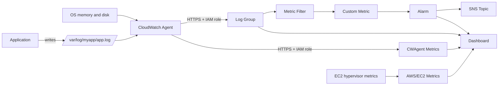

# AWS CloudWatch for EC2 VMs: Metrics, Application Logs and Dashboards

> **Audience:** cloud training class (beginner to intermediate)
> **Assumption:** an EC2 Linux instance (Amazon Linux 2023) is already running. EC2 creation is skipped.
> **Region used in examples:** `us-east-1` (replace with yours)

---

## 1. What is CloudWatch?

CloudWatch is AWS's native monitoring and observability service. For a VM (EC2) it answers three questions:

| Question | CloudWatch feature | Example |
|---|---|---|
| How is the VM performing? | **Metrics** | CPU, network, disk, memory |
| What is the application saying? | **Logs** | `app.log`, Nginx error log |
| Who should know when it breaks? | **Alarms** | Email when errors > 5 in 5 min |
| Where do I see it all? | **Dashboards** | One page with graphs and log tables |

### Key terms

| Term | Meaning |
|---|---|
| Namespace | Container for metrics (`AWS/EC2`, `CWAgent`, `MyApp`) |
| Metric | A time-ordered set of data points (e.g. `CPUUtilization`) |
| Dimension | Name/value pair that identifies a metric (`InstanceId=i-0abc...`) |
| Log group | Collection of log streams, shares retention and permissions |
| Log stream | Sequence of events from one source (usually one instance) |
| Metric filter | Rule that turns log text patterns into a numeric metric |
| CloudWatch Agent | Software on the VM that ships logs and extra metrics |

---

## 2. Architecture

### 2.1 Data flow (ASCII)

```
 ┌──────────────────────────── EC2 Instance ────────────────────────────┐
 │                                                                      │
 │   Application ──writes──► /var/log/myapp/app.log                     │
 │   Nginx       ──writes──► /var/log/nginx/error.log                   │
 │                                   │                                  │
 │                                   ▼                                  │
 │                       ┌─────────────────────┐                        │
 │   OS memory/disk ───► │  CloudWatch Agent   │                        │
 │                       └──────────┬──────────┘                        │
 │                                  │  uses IAM Instance Profile        │
 └──────────────────────────────────┼───────────────────────────────────┘
                                    │ HTTPS (443)
                                    ▼
        ┌────────────────────── Amazon CloudWatch ──────────────────────┐
        │                                                               │
        │  Log Groups ──► Logs Insights (queries)                       │
        │       │                                                       │
        │       └──► Metric Filter ──► Custom Metric (MyApp/ErrorCount) │
        │                                    │                          │
        │  Metrics (AWS/EC2 + CWAgent) ──────┤                          │
        │                                    ▼                          │
        │                               Alarm ──► SNS ──► Email/Slack   │
        │                                    │                          │
        │                                    ▼                          │
        │                              Dashboard                        │
        └───────────────────────────────────────────────────────────────┘
```

### 2.2 Data flow (Mermaid, renders on GitHub/most Markdown viewers)



---

## 3. What you get by default vs. with the agent

| Capability | Default (no agent) | With CloudWatch Agent |
|---|---|---|
| CPU utilization | Yes | Yes |
| Network in/out | Yes | Yes |
| Disk I/O (EBS) | Yes | Yes |
| **Memory usage** | **No** | **Yes** |
| **Disk space used %** | **No** | **Yes** |
| **Application logs** | **No** | **Yes** |
| Metric interval | 5 min (1 min with detailed monitoring) | Down to 1 s (high-resolution) |
| Why | Measured by hypervisor, outside the OS | Runs inside the OS |

> **Teaching point:** The hypervisor cannot see inside your VM, so memory, disk space and log files are invisible until you install an agent.

---

## 4. Prerequisites

- A running EC2 Linux instance with outbound internet access (or VPC endpoints for CloudWatch)
- SSH or Session Manager access to the instance
- Permission to create IAM roles and CloudWatch resources
- AWS CLI configured on your laptop (for the CLI examples)

---

## 5. Step-by-step

### Step 1: Give the instance permission (IAM role)

The agent needs permission to call CloudWatch. Never put access keys on the VM. Use an **instance profile**.

```
 EC2 Instance ──► Instance Profile ──► IAM Role ──► CloudWatchAgentServerPolicy
```

**Console**

1. IAM → **Roles** → **Create role**
2. Trusted entity: **AWS service** → use case **EC2**
3. Attach policy: **CloudWatchAgentServerPolicy**
4. (Optional) also attach **AmazonSSMManagedInstanceCore** to manage via Systems Manager
5. Name it `EC2-CloudWatchAgent-Role` → **Create role**
6. EC2 → select instance → **Actions → Security → Modify IAM role** → pick the role → **Update IAM role**

**CLI equivalent**

```bash
# Trust policy
cat > trust.json <<'EOF'
{
  "Version": "2012-10-17",
  "Statement": [{
    "Effect": "Allow",
    "Principal": { "Service": "ec2.amazonaws.com" },
    "Action": "sts:AssumeRole"
  }]
}
EOF

aws iam create-role --role-name EC2-CloudWatchAgent-Role \
  --assume-role-policy-document file://trust.json

aws iam attach-role-policy --role-name EC2-CloudWatchAgent-Role \
  --policy-arn arn:aws:iam::aws:policy/CloudWatchAgentServerPolicy

aws iam create-instance-profile --instance-profile-name EC2-CloudWatchAgent-Profile
aws iam add-role-to-instance-profile \
  --instance-profile-name EC2-CloudWatchAgent-Profile \
  --role-name EC2-CloudWatchAgent-Role

aws ec2 associate-iam-instance-profile \
  --instance-id i-0123456789abcdef0 \
  --iam-instance-profile Name=EC2-CloudWatchAgent-Profile
```

---

### Step 2: Install the CloudWatch Agent

SSH into the instance.

```bash
# Amazon Linux 2023 / Amazon Linux 2
sudo dnf install -y amazon-cloudwatch-agent      # AL2023
# sudo yum install -y amazon-cloudwatch-agent    # AL2

# Ubuntu/Debian
# wget https://amazoncloudwatch-agent.s3.amazonaws.com/ubuntu/amd64/latest/amazon-cloudwatch-agent.deb
# sudo dpkg -i amazon-cloudwatch-agent.deb
```

Confirm:

```bash
/opt/aws/amazon-cloudwatch-agent/bin/amazon-cloudwatch-agent-ctl -a status
```

Expected: `"status": "stopped"` (installed, not yet configured).

---

### Step 3: Prepare a sample application log

If you already have an app, skip this. For class demos, generate a log that includes INFO, WARN and ERROR lines.

```bash
sudo mkdir -p /var/log/myapp
sudo chmod 755 /var/log/myapp

cat <<'EOF' | sudo tee /usr/local/bin/fake-app.sh
#!/bin/bash
LEVELS=(INFO INFO INFO WARN ERROR)
while true; do
  LEVEL=${LEVELS[$RANDOM % ${#LEVELS[@]}]}
  echo "$(date '+%Y-%m-%d %H:%M:%S') $LEVEL order-service message=\"processed request id=$RANDOM\"" >> /var/log/myapp/app.log
  sleep 2
done
EOF

sudo chmod +x /usr/local/bin/fake-app.sh
sudo nohup /usr/local/bin/fake-app.sh >/dev/null 2>&1 &
tail -f /var/log/myapp/app.log
```

Sample output:

```
2026-11-28 10:15:02 INFO order-service message="processed request id=21874"
2026-11-28 10:15:04 ERROR order-service message="processed request id=9120"
```

---

### Step 4: Create the agent configuration

The agent reads one JSON file telling it **which files to ship** and **which metrics to collect**.

```bash
sudo mkdir -p /opt/aws/amazon-cloudwatch-agent/etc

cat <<'EOF' | sudo tee /opt/aws/amazon-cloudwatch-agent/etc/amazon-cloudwatch-agent.json
{
  "agent": {
    "metrics_collection_interval": 60,
    "run_as_user": "root"
  },
  "logs": {
    "logs_collected": {
      "files": {
        "collect_list": [
          {
            "file_path": "/var/log/myapp/app.log",
            "log_group_name": "/ec2/myapp/application",
            "log_stream_name": "{instance_id}",
            "retention_in_days": 7,
            "timestamp_format": "%Y-%m-%d %H:%M:%S"
          },
          {
            "file_path": "/var/log/messages",
            "log_group_name": "/ec2/myapp/system",
            "log_stream_name": "{instance_id}",
            "retention_in_days": 7
          }
        ]
      }
    }
  },
  "metrics": {
    "namespace": "CWAgent",
    "append_dimensions": {
      "InstanceId": "${aws:InstanceId}"
    },
    "metrics_collected": {
      "mem":  { "measurement": ["mem_used_percent"] },
      "disk": { "measurement": ["used_percent"], "resources": ["/"] }
    }
  }
}
EOF
```

#### Config field reference

| Field | Purpose |
|---|---|
| `file_path` | File to tail (wildcards allowed, e.g. `/var/log/myapp/*.log`) |
| `log_group_name` | Where logs land in CloudWatch |
| `log_stream_name` | Sub-folder per source; `{instance_id}` keeps instances apart |
| `retention_in_days` | Auto-delete old logs (controls cost) |
| `timestamp_format` | Tells CloudWatch how to read the time in each line |
| `namespace` | Namespace for agent metrics (default `CWAgent`) |
| `append_dimensions` | Adds `InstanceId` so metrics can be filtered per VM |

> **Tip:** Use the interactive wizard instead of hand-writing JSON:
> `sudo /opt/aws/amazon-cloudwatch-agent/bin/amazon-cloudwatch-agent-config-wizard`

---

### Step 5: Start the agent

```bash
sudo /opt/aws/amazon-cloudwatch-agent/bin/amazon-cloudwatch-agent-ctl \
  -a fetch-config -m ec2 -s \
  -c file:/opt/aws/amazon-cloudwatch-agent/etc/amazon-cloudwatch-agent.json
```

| Flag | Meaning |
|---|---|
| `-a fetch-config` | Load the config |
| `-m ec2` | Running on EC2 |
| `-s` | Start/restart the agent after loading |
| `-c file:...` | Config source |

Verify:

```bash
sudo /opt/aws/amazon-cloudwatch-agent/bin/amazon-cloudwatch-agent-ctl -a status
sudo tail -n 30 /opt/aws/amazon-cloudwatch-agent/logs/amazon-cloudwatch-agent.log
```

Expected status: `"status": "running"`.

---

### Step 6: Verify logs in CloudWatch

1. Console → **CloudWatch** → **Logs** → **Log groups**
2. Open `/ec2/myapp/application`
3. Open the stream named after your instance ID
4. You should see new lines arriving every few seconds

### Search logs with Logs Insights

CloudWatch → **Logs Insights** → select log group `/ec2/myapp/application`.

**Recent errors**

```
fields @timestamp, @message
| filter @message like /ERROR/
| sort @timestamp desc
| limit 20
```

**Count by log level per 5 minutes**

```
parse @message "* * order-service" as ts, level
| stats count(*) as events by level, bin(5m)
```

**Error rate**

```
parse @message "* * order-service" as ts, level
| stats sum(level="ERROR") / count(*) * 100 as error_pct by bin(5m)
```

---

### Step 7: Turn log lines into a metric (metric filter)

Counts `ERROR` lines so you can graph and alarm on them.

**Console:** Log group → **Metric filters** → **Create metric filter**

| Setting | Value |
|---|---|
| Filter pattern | `ERROR` |
| Metric namespace | `MyApp` |
| Metric name | `AppErrorCount` |
| Metric value | `1` |
| Default value | `0` |

**CLI**

```bash
aws logs put-metric-filter \
  --log-group-name /ec2/myapp/application \
  --filter-name ErrorCount \
  --filter-pattern "ERROR" \
  --metric-transformations \
    metricName=AppErrorCount,metricNamespace=MyApp,metricValue=1,defaultValue=0
```

> A metric filter only counts events that arrive **after** it is created.

---

### Step 8: Create an alarm (optional but recommended)

```bash
# Notification topic
aws sns create-topic --name app-alerts
aws sns subscribe --topic-arn arn:aws:sns:us-east-1:111122223333:app-alerts \
  --protocol email --notification-endpoint you@example.com
# Confirm the subscription from your inbox

aws cloudwatch put-metric-alarm \
  --alarm-name myapp-high-errors \
  --namespace MyApp --metric-name AppErrorCount \
  --statistic Sum --period 300 --evaluation-periods 1 \
  --threshold 5 --comparison-operator GreaterThanThreshold \
  --treat-missing-data notBreaching \
  --alarm-actions arn:aws:sns:us-east-1:111122223333:app-alerts
```

Memory alarm example:

```bash
aws cloudwatch put-metric-alarm \
  --alarm-name vm-high-memory \
  --namespace CWAgent --metric-name mem_used_percent \
  --dimensions Name=InstanceId,Value=i-0123456789abcdef0 \
  --statistic Average --period 300 --evaluation-periods 2 \
  --threshold 80 --comparison-operator GreaterThanThreshold \
  --alarm-actions arn:aws:sns:us-east-1:111122223333:app-alerts
```

---

## 6. Build the dashboard

### 6.1 Planned layout

```
┌───────────────────────────────────────────────────────────────┐
│  Dashboard: myapp-ec2-monitoring                              │
├─────────────────────────┬─────────────────────────────────────┤
│  CPU Utilization (%)    │  Memory Used (%)                    │
│  AWS/EC2                │  CWAgent                            │
├─────────────────────────┼─────────────────────────────────────┤
│  Disk Used (%)          │  Network In / Out                   │
│  CWAgent                │  AWS/EC2                            │
├─────────────────────────┼─────────────────────────────────────┤
│  App Errors (Sum / 5m)  │  Alarm Status                       │
│  MyApp/AppErrorCount    │  myapp-high-errors, vm-high-memory  │
├─────────────────────────┴─────────────────────────────────────┤
│  Logs table: latest ERROR lines (Logs Insights query)         │
└───────────────────────────────────────────────────────────────┘
```

### 6.2 Console method

1. CloudWatch → **Dashboards** → **Create dashboard** → name `myapp-ec2-monitoring`
2. Choose widget type **Line** → **Metrics**
3. **Widget 1, CPU:** EC2 → Per-Instance Metrics → select `CPUUtilization` for your instance
4. **Add widget → Line → Metrics:** CWAgent → select `mem_used_percent` for your instance
5. **Add widget → Line:** CWAgent → `disk_used_percent` (path `/`)
6. **Add widget → Line:** EC2 → `NetworkIn`, `NetworkOut`
7. **Add widget → Number or Line:** MyApp → `AppErrorCount` (statistic **Sum**, period **5 minutes**)
8. **Add widget → Alarm status:** select both alarms
9. **Add widget → Logs table:** log group `/ec2/myapp/application`, query:
   ```
   fields @timestamp, @message
   | filter @message like /ERROR/
   | sort @timestamp desc
   | limit 20
   ```
10. Arrange widgets, set time range (e.g. 3h) and **auto-refresh** (1 min), then **Save dashboard**

### 6.3 CLI / Infrastructure-as-Code method

Replace `INSTANCE_ID` and region before running. The disk metric also carries `device` and `fstype` dimensions; check them in the console under **Metrics → CWAgent** and adjust.

```bash
cat > dashboard.json <<'EOF'
{
  "widgets": [
    {
      "type": "metric", "x": 0, "y": 0, "width": 12, "height": 6,
      "properties": {
        "title": "CPU Utilization (%)",
        "region": "us-east-1", "view": "timeSeries", "stat": "Average", "period": 300,
        "metrics": [["AWS/EC2", "CPUUtilization", "InstanceId", "INSTANCE_ID"]]
      }
    },
    {
      "type": "metric", "x": 12, "y": 0, "width": 12, "height": 6,
      "properties": {
        "title": "Memory Used (%)",
        "region": "us-east-1", "view": "timeSeries", "stat": "Average", "period": 60,
        "metrics": [["CWAgent", "mem_used_percent", "InstanceId", "INSTANCE_ID"]]
      }
    },
    {
      "type": "metric", "x": 0, "y": 6, "width": 12, "height": 6,
      "properties": {
        "title": "Disk Used (%)",
        "region": "us-east-1", "view": "timeSeries", "stat": "Average", "period": 300,
        "metrics": [["CWAgent", "disk_used_percent", "InstanceId", "INSTANCE_ID",
                     "path", "/", "device", "xvda1", "fstype", "xfs"]]
      }
    },
    {
      "type": "metric", "x": 12, "y": 6, "width": 12, "height": 6,
      "properties": {
        "title": "Network In / Out (bytes)",
        "region": "us-east-1", "view": "timeSeries", "stat": "Sum", "period": 300,
        "metrics": [
          ["AWS/EC2", "NetworkIn",  "InstanceId", "INSTANCE_ID"],
          ["AWS/EC2", "NetworkOut", "InstanceId", "INSTANCE_ID"]
        ]
      }
    },
    {
      "type": "metric", "x": 0, "y": 12, "width": 12, "height": 6,
      "properties": {
        "title": "Application Errors (Sum / 5 min)",
        "region": "us-east-1", "view": "timeSeries", "stat": "Sum", "period": 300,
        "metrics": [["MyApp", "AppErrorCount"]]
      }
    },
    {
      "type": "alarm", "x": 12, "y": 12, "width": 12, "height": 6,
      "properties": {
        "title": "Alarm Status",
        "alarms": [
          "arn:aws:cloudwatch:us-east-1:111122223333:alarm:myapp-high-errors",
          "arn:aws:cloudwatch:us-east-1:111122223333:alarm:vm-high-memory"
        ]
      }
    },
    {
      "type": "log", "x": 0, "y": 18, "width": 24, "height": 6,
      "properties": {
        "title": "Latest application errors",
        "region": "us-east-1", "view": "table",
        "query": "SOURCE '/ec2/myapp/application' | fields @timestamp, @message | filter @message like /ERROR/ | sort @timestamp desc | limit 20"
      }
    }
  ]
}
EOF

aws cloudwatch put-dashboard \
  --dashboard-name myapp-ec2-monitoring \
  --dashboard-body file://dashboard.json
```

---

## 7. Troubleshooting

| Symptom | Likely cause | Fix |
|---|---|---|
| No log group appears | Missing IAM permissions | Confirm role is attached and has `CloudWatchAgentServerPolicy` |
| Agent log shows `AccessDenied` or `NoCredentialProviders` | No instance profile | Re-attach the role (Step 1) |
| Agent log shows connection timeout | No route to CloudWatch | Check NAT gateway, internet gateway, or VPC endpoints for `logs` and `monitoring` |
| Log group exists, no events | Wrong `file_path` or file unreadable | `ls -l` the file; keep `run_as_user` as `root` or fix permissions |
| Timestamps look wrong | `timestamp_format` mismatch | Match the format in your log lines exactly |
| Memory metric missing | Config lacks `mem` section or wrong dimensions | Check `Metrics → CWAgent`; confirm `InstanceId` dimension |
| Dashboard widget empty | Dimension values differ from metric | Pick the metric from the console picker, then copy its dimensions |
| Old log lines never appear | Agent only reads new lines by default | Append new lines, or set `"from_beginning"` handling per agent docs |

Useful commands:

```bash
sudo systemctl status amazon-cloudwatch-agent
sudo tail -f /opt/aws/amazon-cloudwatch-agent/logs/amazon-cloudwatch-agent.log
sudo /opt/aws/amazon-cloudwatch-agent/bin/amazon-cloudwatch-agent-ctl -a stop
```

---

## 8. Cost and best practices

| Practice | Why |
|---|---|
| Set `retention_in_days` on every log group | Default is "never expire", which keeps costing money |
| Log at INFO and above in production | DEBUG floods ingestion |
| One log group per application and environment | Simpler permissions and queries |
| Use structured (JSON) logs | Logs Insights can query fields directly |
| Avoid high-cardinality dimensions | Each unique dimension set is a billable custom metric |
| Manage agent config in SSM Parameter Store | Same config across many instances |
| Add alarms before dashboards | Dashboards need a human watching; alarms do not |

---

## 9. Classroom discussion

1. Why can't the default EC2 metrics show memory usage? What does that tell you about the shared-responsibility model?
2. We used an IAM role instead of access keys. List three risks of putting keys on the VM.
3. A metric filter only counts future log lines. How would you backfill historical error counts?
4. Your app produces 50 GB of logs per day. Which three levers reduce cost?
5. When would you pick **Logs Insights** over a **metric filter**, and vice versa?

### Compare and contrast

| | Metric filter | Logs Insights |
|---|---|---|
| Runs | Continuously on incoming logs | On demand, over a time range |
| Output | A metric (graph, alarm) | Query result table |
| Good for | Alerting | Investigation |
| Cost model | Custom metric charge | Per GB scanned |
| Historical data | No | Yes |

---

## 10. Hands-on lab (30 to 40 minutes)

| # | Task | Done when |
|---|---|---|
| 1 | Attach the IAM role to your instance | Role shows on instance details |
| 2 | Install and start the agent | Status is `running` |
| 3 | Run the fake app and ship `app.log` | Events visible in the log group |
| 4 | Write a Logs Insights query for `WARN` lines | Query returns rows |
| 5 | Create the `AppErrorCount` metric filter | Metric visible under `MyApp` |
| 6 | Create the alarm with your email | You receive a test alert |
| 7 | Build the dashboard | All 7 widgets show data |
| **Stretch** | Add a JSON-formatted log and parse fields in Insights | Query groups by a JSON field |

---

## 11. Cleanup

```bash
sudo pkill -f fake-app.sh
sudo /opt/aws/amazon-cloudwatch-agent/bin/amazon-cloudwatch-agent-ctl -a stop

aws cloudwatch delete-dashboards --dashboard-names myapp-ec2-monitoring
aws cloudwatch delete-alarms --alarm-names myapp-high-errors vm-high-memory
aws logs delete-metric-filter --log-group-name /ec2/myapp/application --filter-name ErrorCount
aws logs delete-log-group --log-group-name /ec2/myapp/application
aws logs delete-log-group --log-group-name /ec2/myapp/system
aws sns delete-topic --topic-arn arn:aws:sns:us-east-1:111122223333:app-alerts
```

---

## 12. Quick reference

| Task | Command or location |
|---|---|
| Agent status | `amazon-cloudwatch-agent-ctl -a status` |
| Agent config file | `/opt/aws/amazon-cloudwatch-agent/etc/amazon-cloudwatch-agent.json` |
| Agent log | `/opt/aws/amazon-cloudwatch-agent/logs/amazon-cloudwatch-agent.log` |
| Required IAM policy | `CloudWatchAgentServerPolicy` |
| Agent metric namespace | `CWAgent` |
| EC2 metric namespace | `AWS/EC2` |
| Tail logs from CLI | `aws logs tail /ec2/myapp/application --follow` |